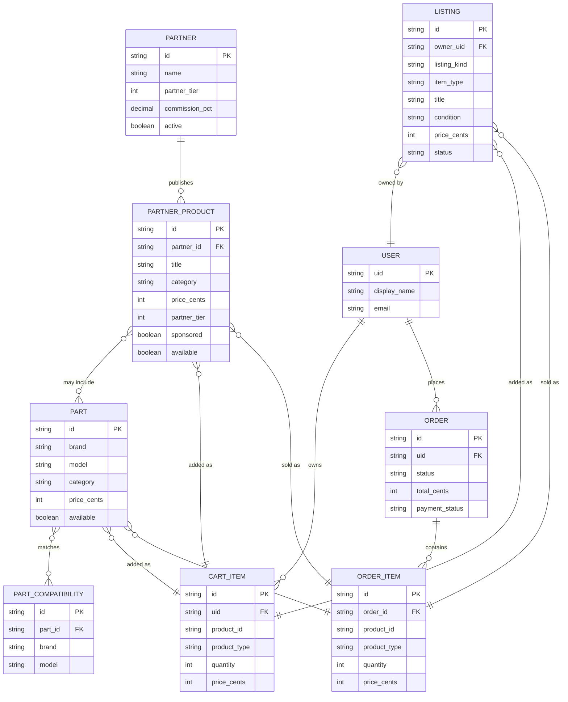

# Data Architecture & Persistence Layer

The marketplace persistence layer uses Cloud Firestore with Firebase Storage for
images. The backend uses the Firebase Admin SDK rather than an ORM; Android
clients access marketplace data through the FastAPI service and authenticated
Firebase Storage uploads.

## Database Configuration

| Service/Module | DB Type | Profile | Driver | Connection | Migration Tool |
|---|---|---|---|---|---|
| Backend marketplace persistence | Cloud Firestore | Default/runtime | Firebase Admin SDK | `FIREBASE_PROJECT_ID` and service-account credentials | None; Firestore collections and indexes are managed as deployment configuration |
| Backend media storage | Firebase Cloud Storage | Default/runtime | Firebase Admin Storage SDK | Firebase Admin app bucket | None; Storage rules are deployed configuration |
| Android marketplace media | Firebase Cloud Storage | Android runtime | Firebase Storage client SDK | Firebase project configured by `google-services.json` | None |

Firestore timestamps are server-generated. Monetary values are accepted as
decimal API values and stored as integer `price_cents`. Composite query indexes
are declared in [firestore.indexes.json](../../../../../firestore.indexes.json).

## Data Ownership per Service

| Service | Tables Owned | ORM Framework | Caching | Notes |
|---|---|---|---|---|
| FastAPI marketplace service | `partners`, `partner_products`, `parts`, `part_compatibility`, `listings`, `carts`, `orders` | None; Firebase Admin Firestore SDK | None | Backend/admin owns catalogue writes; user listing writes are owner-scoped |
| Android marketplace client | No authoritative collections; uploads media to `marketplace/<uid>` | None; Firebase client SDK and OkHttp | None | Search and listing mutations use backend API; media is uploaded before listing creation |
| Android app (user data) | `users/<uid>` and its subcollections (`appliances`, `chats`, `manuals`, `bookmarks`, `ratings`), `ratings` | None; Firebase client SDK | Firestore offline cache on the phone | Only the owner reads and writes them, so profile, appliances and chats follow the user to a new phone |
| Firebase Storage | Marketplace images, profile photos, chat photos | None | None | Authenticated users may write only to their own `marketplace/<uid>` and `users/<uid>` paths; images only, up to 10 MB |

## Entity Model

The diagram models the marketplace collections documented in
[marketplace-data-dictionary.md](../../../../../docs/marketplace-data-dictionary.md).
`cart_items` and `order_items` represent documents in the corresponding
subcollections.

<!-- mermaid-checked: every attribute is `<type> <name> [<key>] ["<description>"]` with at most one of PK/FK/UK, no \n in descriptions, no {} in descriptions, every relationship label is double-quoted -->

The catalogue, cart, and order collections are planned persistence boundaries;
the current implemented API increment covers marketplace search and user
listing creation/deletion. Cart, checkout, payment, and partner-admin writes
remain separate increments.

## Key Repository Methods

| Service | Repository | Notable Methods | Purpose |
|---|---|---|---|
| FastAPI marketplace service | `api/firebase_store.py` | `search_marketplace(query, item_type, category, brand, min_price, max_price, cursor, limit)` | Reads and merges active listings, official partner products, and available parts, then ranks results |
| FastAPI marketplace service | `api/firebase_store.py` | `create_marketplace_listing(user_uid, payload, seller_name)` | Normalizes a user listing and writes it to `listings` |
| FastAPI marketplace service | `api/firebase_store.py` | `delete_marketplace_listing(user_uid, listing_id)` | Deletes a listing only after verifying ownership |
| FastAPI marketplace service | `api/firebase_store.py` | `get_firestore_client()` | Lazily initializes the Admin SDK Firestore client |

## Caching Strategy

No application cache, Redis layer, Firestore query cache, or second-level ORM
cache is configured. `get_firestore_client` uses a process-local singleton via
`lru_cache`; this caches the client instance, not marketplace results.

## Data Ownership Boundaries

Firestore is a shared logical datastore with collection-level ownership
boundaries. Backend/admin code owns partner catalogue writes. User clients can
read public partner products, parts, and active listings, while user-created
listing creation and deletion are constrained to the authenticated owner.
Marketplace search currently uses the backend Admin SDK to merge the three
catalogue sources rather than performing cross-service database calls.

The backend prevents user listing payloads from setting `sponsored`,
`partner_tier`, `partner_id`, or `commission_pct`. Partner ranking is therefore
backend-controlled. The current search implementation applies relevance,
sponsorship, and partner-tier weights to in-memory merged results; Firestore
indexes support future query-based pagination and filtering.

### Data Classification & Sensitivity

| Entity | Sensitive Fields | Classification | Controls in Place |
|---|---|---|---|
| `USER` and listing owner identity | `uid`, seller name, email | PII | Authentication and owner checks; no field-level encryption or masking configured |
| `LISTING` | seller name, pickup postcode, image and diagnostic media URLs | PII | Owner-scoped writes; Storage path ownership; public reads for active listings; no field-level encryption or masking configured |
| `ORDER` | buyer identity and payment status | PII; payment metadata may become PCI-relevant | Backend/payment flow is not implemented in this increment; no card data should be stored in Firestore |
| `PARTNER` | partner contact or commercial fields if added | Business-sensitive | Backend/admin write boundary; no field-level encryption configured |

